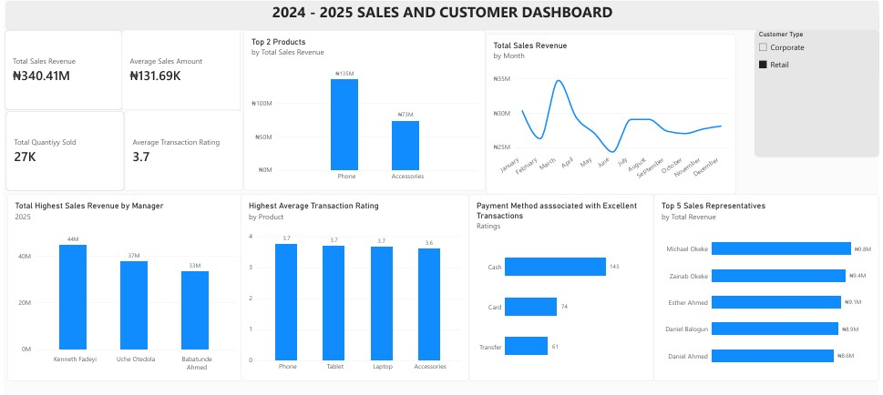

# Retail Sales Performance Growth & Customer Experience Analysis

## Executive Summary

This project evaluates 2024–2025 retail sales performance across products, regions, customer segments, payment channels, transaction quality, and sales representatives.

The analysis identified strong top-line growth, but also showed that growth was primarily volume-driven rather than value-driven. Revenue increased by 102% year-on-year, yet average transaction value remained effectively flat.

The analysis therefore focused not only on what grew, but on whether that growth was sustainable, where operational risks were emerging, and which commercial levers could support the next stage of expansion.

## Business Context

The business generated **₦340.4M in total revenue** across 2024–2025 and more than doubled annual revenue from **₦112.7M in 2024 to ₦227.7M in 2025**.

Despite this growth, several questions remained:

- Is revenue growth being driven by higher-value transactions or simply more transactions?
- Which products and regions are driving performance?
- Where are customer experience issues concentrated?
- Which payment and fulfilment channels perform best?
- Are there underperforming sales representatives or regions that require intervention?
- What operational and commercial actions could support more sustainable growth?

## Analytical Objectives

The analysis was designed to assess:

- Revenue growth and year-on-year performance
- Transaction volume and average deal value
- Product contribution and growth
- Regional performance and geographic concentration
- Customer segment performance
- Payment-channel behaviour
- Transaction ratings and customer experience
- Sales representative performance
- Data quality risks affecting business decision-making

## Tools & Methods

**Tools**
- Power BI
- Power Query
- Microsoft Excel
- PivotTables

**Analytical Methods**
- Year-on-year variance analysis
- Product and regional contribution analysis
- Customer segmentation
- Transaction-rating analysis
- Sales representative performance analysis
- Payment-channel comparison
- Data-quality assessment
- KPI development
- Executive dashboard design

## Data Preparation & Quality Controls

Before analysis, the dataset required multiple transformation and validation steps.

Key data-quality actions included:

- Standardizing inconsistent product categories
- Correcting spelling inconsistencies
- Removing blank records
- Handling missing values
- Reviewing negative transaction values
- Separating completed sales from returns and non-sale transaction types
- Validating calculated sales values
- Reviewing incomplete customer contact information
- Assessing inconsistencies between quantity and recorded sales amount

These steps were necessary to ensure that subsequent KPIs and comparisons reflected valid commercial activity.

## Dashboard

## Performance Diagnosis

### 1. Revenue growth was strong, but almost entirely volume-driven

Revenue increased from **₦112.7M in 2024 to ₦227.7M in 2025**, representing **102% growth**.

However, average transaction value remained broadly unchanged at approximately **₦131.6K–₦131.7K**.

This indicates that the business doubled revenue primarily by processing more transactions rather than increasing customer spend per transaction.

**Implication:**  
The current growth model depends heavily on continued transaction-volume expansion. Without increases in basket size or pricing power, future growth may become increasingly operationally expensive.

---

### 2. Growth momentum weakened after Q1 2025

Q1 2025 generated approximately **₦61.5M**, but Q2–Q4 averaged roughly **₦55.4M**, around 10% lower.

March 2025 was the strongest month, while September was the weakest month of the year.

**Implication:**  
Although year-on-year performance remained strong, the internal 2025 trend suggests growth momentum had begun to plateau.

This creates a need for new revenue drivers rather than relying solely on transaction volume.

---

### 3. Product performance was concentrated

Phones generated approximately **₦134.6M**, representing roughly **39.5% of total revenue**.

Accessories, Tablets and Laptops contributed significantly less, although Tablets recorded the strongest growth rate.

**Implication:**  
Phones remain the primary commercial engine, creating both an opportunity and a concentration risk.

The business should protect Phone performance while using complementary products to increase average transaction value.

---

### 4. Regional growth was uneven

Port Harcourt recorded the strongest regional growth at approximately **127%**, generating **₦80.1M in 2025**.

Lagos grew more slowly at approximately **84%**, moving from the strongest region in 2024 to the weakest of the three major regions in 2025.

**Implication:**  
The difference suggests that performance is not being driven solely by market size.

Commercial practices, sales execution, local customer mix or regional management may be contributing to the gap.

---

### 5. Retail customers became increasingly important

Retail revenue increased by approximately **114%**, compared with approximately **92% growth in Corporate revenue**.

Retail overtook Corporate revenue in 2025.

**Implication:**  
The business is becoming increasingly consumer-led, which may affect future decisions around pricing, promotions, fulfilment and retention strategy.

---

### 6. Customer experience represents a material commercial risk

Approximately **21% of transactions were rated Poor or Very Poor**, representing 544 transactions and approximately **₦72.1M in associated revenue**.

Urgent Delivery recorded the highest Poor/Very Poor rate, while some individual sales representatives showed dissatisfaction rates substantially above the overall business average.

**Implication:**  
Revenue growth is occurring alongside customer-experience risk.

If unresolved, service-quality problems could weaken retention and reduce the sustainability of future growth.

---

### 7. Fulfilment appears to be a stronger dissatisfaction driver than product mix

Urgent Delivery transactions recorded the weakest customer ratings.

By comparison, differences across product categories were less pronounced.

**Implication:**  
The customer experience issue appears operational rather than primarily product-related.

Logistics and delivery processes therefore represent a priority area for investigation.

---

### 8. Payment behaviour reveals a customer-experience opportunity

Cash generated approximately **51% of total revenue**, making it the dominant payment channel.

However, Transfer transactions recorded the strongest average customer rating and the lowest share of Poor/Very Poor ratings.

**Implication:**  
Encouraging digital payment adoption may improve both operational efficiency and customer experience.

---

### 9. Sales performance is broadly distributed

The highest-performing sales representative generated approximately **₦9.8M**, while the top 10 representatives accounted for only around 25% of total revenue.

**Implication:**  
Revenue is not overly dependent on a small number of salespeople.

This reduces key-person risk and suggests the business has a relatively broad sales-performance base.

---

### 10. Data-quality gaps could limit customer strategy

A meaningful share of records lacked complete customer contact information.

The analysis also identified inconsistencies between transaction quantity and sales value.

**Implication:**  
Incomplete customer data reduces the organization's ability to perform retention analysis, CRM segmentation, lifecycle marketing and customer-level profitability analysis.

## Strategic Recommendations

### 1. Shift the growth model from volume to value

Introduce product bundles, cross-selling and upselling strategies designed to increase average transaction value.

A practical target would be a **10% increase in average ticket size**.

### 2. Protect customer experience before scaling further

Prioritize investigation of Poor and Very Poor transactions, particularly those linked to Urgent Delivery.

Track customer-rating performance as an operational KPI.

### 3. Replicate high-performing regional practices

Conduct a structured review of Port Harcourt's commercial model and compare it with Lagos.

Identify differences in:
- customer mix
- sales execution
- promotions
- fulfilment
- representative performance

Use these findings to develop a Lagos recovery plan.

### 4. Improve sales-performance management

Identify representatives with unusually high Poor/Very Poor transaction rates and introduce targeted coaching.

Customer satisfaction should be monitored alongside revenue rather than treating sales volume as the only performance measure.

### 5. Increase adoption of Transfer and Card payments

Encourage customers to use digital payment methods through process improvements or small incentives.

This may reduce cash-handling risk while aligning more transactions with the channels associated with stronger customer ratings.

### 6. Strengthen CRM and customer-data capture

Make key customer details such as email and phone number mandatory where operationally appropriate.

A more complete CRM dataset would support:
- repeat-purchase analysis
- customer segmentation
- retention programmes
- lifetime-value analysis

### 7. Introduce executive KPI monitoring

Future reporting should monitor:

- Revenue growth
- Average transaction value
- Transaction volume
- Customer rating
- Poor/Very Poor transaction rate
- Regional growth
- Repeat customer rate
- Payment mix
- Product contribution
- Sales representative performance

## Business Impact

This analysis reframes the company's performance from a simple story of rapid revenue growth into a more complete picture of commercial sustainability.

The business has successfully doubled revenue, but the next stage of growth is unlikely to come from transaction volume alone.

The strongest opportunities lie in:

- increasing customer value per transaction
- improving fulfilment quality
- addressing regional performance gaps
- strengthening customer retention
- improving CRM and data quality
- maintaining executive visibility over operational KPIs

The dashboard provides management with a structured framework for monitoring these priorities over time.

## Skills Demonstrated

- Business Intelligence
- Power BI Dashboard Development
- Power Query
- KPI Development
- Commercial Performance Analysis
- Customer Analytics
- Product Performance Analysis
- Regional Performance Analysis
- Trend & Variance Analysis
- Root-Cause Analysis
- Data Quality Assessment
- Executive Reporting
- Data Storytelling
- Strategic Recommendation Development

## Project Files

- [Power BI Dashboard](2024_2025_SALES_AND_CUSTOMER_DASHBOARD.pbix)
- [Business Performance Report](Business_Performance_Report_2024_2025.pptx)
